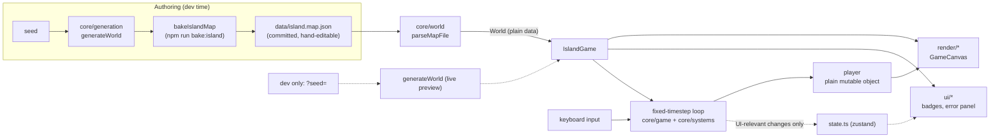
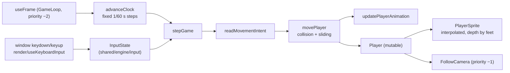
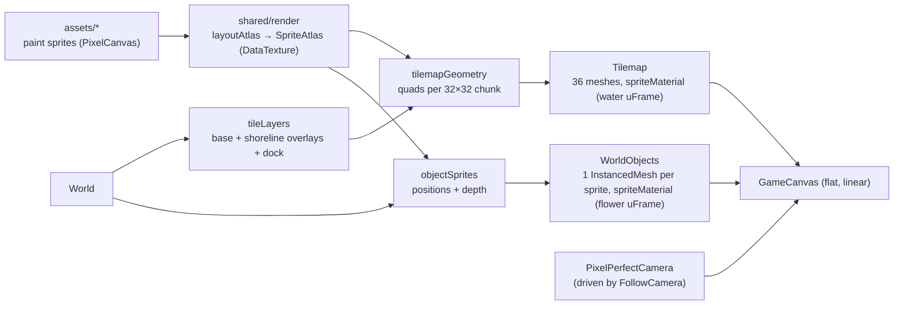

# Architecture

> Status: M3 (player). Sections marked _(planned)_ describe the design the next
> milestones will implement; update them as the code lands.

## Layers

| Layer      | Folders                                                         | May import                            | Tech                |
| ---------- | --------------------------------------------------------------- | ------------------------------------- | ------------------- |
| App / site | `src/app`, `src/pages`                                          | all below (games only via `index.ts`) | React, react-router |
| UI         | `src/games/*/ui`, `src/shared/ui`                               | core, state                           | React DOM           |
| Render     | `src/games/*/render`, `src/games/*/assets`, `src/shared/render` | core, state                           | R3F, three, drei    |
| Core       | `src/games/*/core`, `src/shared/engine`                         | core only                             | Pure TypeScript     |

Dependency direction: **app → ui / render → core**. UI and render are siblings and don't import
each other; the game's root component (`IslandGame.tsx`) composes them. Shared code never
imports a game. All of this is enforced by `no-restricted-imports` blocks in
`eslint.config.js` and verified by `tests/layer-rules.test.ts`.

## Routes

| Route           | What                                                                                                                         |
| --------------- | ---------------------------------------------------------------------------------------------------------------------------- |
| `/`             | **The world**, full screen (lazy; full-screen loading screen on first load). Dev only: `?seed=N` previews a generated island |
| `/games`        | Games list (inside the site `Layout` with header)                                                                            |
| `/games/island` | Redirects to `/` (keeps the query string)                                                                                    |
| anything else   | 404 page                                                                                                                     |

## Folder map

```
src/
  main.tsx                  # Entry: mounts <App/>
  app/                      # App shell: router (HydrateFallback), Layout, SiteMenu, global.css
  pages/                    # WorldPage (/), GamesIndexPage, IslandRedirectPage, loading/error/404
  shared/
    engine/                 # Pure TS: math, random, noise, grid, pathfinding (A*)
    render/                 # pixelCanvas, atlasLayout, spriteAtlas, pixelPerfect, PixelPerfectCamera
    ui/                     # (planned) shared UI components
  games/
    catalog.ts              # Plain metadata for every game (used by the games list)
    island/
      index.ts              # Public API: IslandGame
      IslandGame.tsx        # Loads the world; composes render + UI
      loadWorld.ts          # Baked island, or a generated one for a dev seed; never throws
      state.ts              # zustand store, UI-facing state only (unused until M4)
      data/island.map.json  # THE world: baked, committed map file (chunked, readable)
      core/
        config.ts           # IslandConfig: every tunable number
        world/              # tiles, objects (registries), world (type), collision,
                            #   mapFile (format + writer), parseMapFile, bakedIsland (loader)
        generation/         # authoring tool: context, steps/*, validate, pipeline,
                            #   generateWorld, bakeIslandMap
        entities/           # player.ts (plain mutable player, feet hitbox)
        systems/            # controls (bindings, intent), movement (collision), animation
        game/               # gameState.ts: createGameState, stepGame, advanceGame
      render/               # GameCanvas, Tilemap (+ tileLayers, tilemapGeometry), spriteMaterial,
                            #   WorldObjects (+ objectSprites, objectSpriteKeys), worldSpace,
                            #   spriteCatalog, spriteGeometry, GameLoop, PlayerSprite,
                            #   FollowCamera, useKeyboardInput
      assets/               # palette (ramps), paint helpers, foliage (clump shading),
                            #   paintTiles/Transitions/Objects/Structures/Cabin, playerPixels,
                            #   paintPlayer, islandSprites
      ui/                   # DevSeedBadge, WorldErrorPanel, ControlsHint, islandUi.css
tests/                      # Cross-cutting tests (architecture rules)
scripts/
  bake-island-map.mjs       # npm run bake:island [-- seed]: generator -> data/island.map.json
  browser-check.mjs         # Dev-only headless Chrome check (screenshot + console)
```

## Data flow



## The world is a baked map file

- The live island is **not generated at runtime**. `data/island.map.json` is produced once by
  the generator (`npm run bake:island`), committed, and loaded by `loadBakedIsland()`.
  Changing generation code never moves anything in the live world; only re-baking or editing
  the file does. `bakedIsland.test.ts` guarantees the committed file passes every invariant.
- **Format (version 1):** header (`chunkSize`, `widthChunks`, `heightChunks`, `spawn`,
  `source` seed info) + `chunks[]`. Each chunk has chunk coordinates `x`/`y`, `rows` (one
  string per tile row, one character per tile — `mapChar` in the tile registry) and
  `objects` as `[kind, localX, localY]`. Written one row/object per line for readable diffs.
- **Tile characters:** `~` deep sea, `-` shallow sea, `.` sand, `,` grass, `L` lake water,
  `l` lake shallows, `=` path, `#` dock.
- `parseMapFile` checks everything (version, sizes, known tiles/objects, overlaps, exactly
  one cabin, spawn in bounds) and throws `MapFileError` with a precise message, which the UI
  shows in `WorldErrorPanel`.

## World data

- `World` is plain data: `terrain: Uint8Array` (TileId per tile), `objects: WorldObject[]`
  (kind + top-left tile), `occupancy: Int32Array` (object id per tile or `NO_OBJECT`),
  `blocked: Uint8Array` (collision mask), `cabin`, `spawn`, `seed`, `generationSeed`.
- Grids are row-major (`index = y * width + x`) with **y growing downwards**. Render code
  flips y when converting to Three.js coordinates (y up).
- Rules about tiles and objects come from the registries (`isWalkableTile`, `waterBody`,
  `blocksMovement`, `footprint`, `door`), never from comparing ids in logic.

## Generation pipeline (authoring tool)

`shapeIsland → assignTerrain → carveLake → placeCabin → placeDock → layPaths → decorateCabin →
scatterRocks → scatterTrees → scatterFlowers → chooseSpawn → validate`

| Step             | What it does                                                                                                                                                                                                               |
| ---------------- | -------------------------------------------------------------------------------------------------------------------------------------------------------------------------------------------------------------------------- |
| `shapeIsland`    | Elevation = fractal noise blended with a radial gradient (`radialWeight`)                                                                                                                                                  |
| `assignTerrain`  | Thresholds → deep/shallow sea, sand, grass; deep-sea edge band; keep the largest landmass; fill water not connected to the edge                                                                                            |
| `carveLake`      | Noise-bent blob where the coast distance leaves room for lake + shore + gap; 8-way shallows rim and sand shore                                                                                                             |
| `placeCabin`     | Site where footprint + margin + front clearance are grass, away from water, preferably near the lake; reserves the area                                                                                                    |
| `placeDock`      | Straight dock from a lake-shore sand tile into open water, on the side closest to the cabin door                                                                                                                           |
| `layPaths`       | A* trails from the door to the dock and to beaches (closest, then farthest), noise-perturbed costs so they wind, existing trail is cheap so trails merge; trail tiles reserved                                             |
| `decorateCabin`  | Fence around the cabin's front yard (trail tiles left open = gate) and a mailbox beside the door                                                                                                                           |
| `scatterRocks`   | Rock outcrops from cluster noise plus lone rocks, on free grass/sand                                                                                                                                                       |
| `scatterTrees`   | Dense canopy (big trees on a staggered 2-tile grid) where forest cores meet a "dense" character noise; loose big/small mix elsewhere in forests; rare meadow trees and bushes; crowns never overhang reserved tiles        |
| `scatterFlowers` | Patch noise → flower patches (colour from a colour noise), scattered flowers, grass tufts                                                                                                                                  |
| `chooseSpawn`    | Tile in front of the cabin door if walkable                                                                                                                                                                                |
| `validate`       | `validateMap` (works on generation contexts and loaded maps): deep-sea borders, land share, one lake not touching the sea, a dock, cabin on land, door + every trail/dock tile reachable from spawn, enough reachable land |

- Each step is a pure `(context) => context` function; it copies the arrays it changes.
- Each step draws from its own RNG stream, `createRng(deriveSeed(seed, stepName))`.
- `generateWorld` retries with `deriveSeed(seed, 'retry-N')` up to `generation.maxAttempts`.

## Game loop



- `GameCanvas` creates one `GameState` per world (`createGameState`): world, player, input,
  fixed-step clock, interpolation factor. It is a plain mutable object, never React state.
- Each rendered frame, `GameLoop` calls `advanceGame(state, delta)`, which runs the owed
  fixed steps (`stepGame`: read intent → face → `movePlayer` → `updatePlayerAnimation`) and
  stores the interpolation factor. Then `FollowCamera` eases towards the interpolated player
  position, and `PlayerSprite` draws it (pixel-snapped, facing strip, walk frame,
  `standingSpriteZ(feet)`).
- **Controls:** WASD/arrows walk (8-way, normalised speed; facing = most recently pressed
  direction), Shift runs, +/− zoom. Losing window focus releases all keys.
- **Collision:** a 10×6 px feet hitbox against `world.blocked`; X and Y move separately
  (wall sliding), stop flush at tile edges, and nudge around corners clipped by ≤ 5 px.
- Only UI-relevant values (from M4: the debug flag) go into zustand.

## Rendering



- **Units:** 1 world unit = 1 source pixel; a tile is 16 units. World y = −(map y in px).
- **Atlas:** sprites are painted in code into `PixelCanvas` buffers (`assets/`), packed by
  `layoutAtlas` (power-of-two, 1 px extruded borders) and uploaded as one nearest-filtered
  `DataTexture`. Keys: `tile_<tile key>.N` (variants), `edge_<material>_<n|e|s|w>`,
  `corner_<material>_<ne|se|sw|nw>`, `tile_dock_h|v`, `<object spriteKey>[.N]`, `cabin`.
  Variants are picked per position with `hashCoords`, so the same spot always looks the same.
- **Terrain:** `tileLayersAt` returns the sprites for a tile, bottom to top: base (the
  underlay's sprite for the dock), overlays from higher-`edgePriority` neighbours (edges for
  touching sides, rounded corners for diagonal-only contact, lowest priority first), then the
  dock planks. `buildChunkGeometryData` turns a chunk into quads; animated water quads carry a
  u stride and the shader adds `stride × uFrame`.
- **Objects:** `objectSpriteKey` picks each object's sprite (fence pieces by neighbouring
  fences, otherwise a stable variant); `placeObjectSprites` stands sprites on the bottom edge
  of their footprint (big trees: 32×32 over a 2×1 trunk row; cabin: 48×64 over 3×3). One
  `InstancedMesh` per sprite key with the shared `spriteMaterial` (instancing-aware); flowers
  are 4-frame strips animated by the objects material's own `uFrame`.
- **Style:** classic handheld-RPG-inspired, original, painted in code: colour ramps
  (outline → dark → base → light → highlight), dark outlines, clumpy top-left-lit foliage.
- **Depth:** terrain z = 0 (layers draw in index order), flat decorations z = 0.5, standing
  sprites `standingSpriteZ(footYPx) = 1 + footYPx × 0.01` — the depth buffer puts things lower
  on the map in front, so crowns and the cabin roof cover whatever stands behind them. All
  materials use hard alpha (`alphaTest` / `discard`), so nothing needs sorting.
- **Camera:** `PixelPerfectCamera` (shared) keeps whole device pixels per source pixel, snaps
  to the device-pixel grid (half-pixel fix for odd buffers) and clamps to the map. The scale is
  `autoPixelScale` (~20 tiles across, ≥11 tall) plus a +/− offset, driven by `FollowCamera`.
- **Colour:** the canvas is `flat` + `linear`, so painted colours reach the screen unchanged.
- **Cleanup:** the atlas texture, chunk geometries, both sprite materials and the sprite
  geometries are disposed in effect cleanups; R3F disposes JSX-declared objects.

## How-to guides

### Re-bake or redesign the island

1. Preview candidates in dev: `npm run dev`, open `/?seed=N` (a "Dev preview" badge shows).
2. Bake the chosen seed: `npm run bake:island -- N` (or set `generation.authoringSeed`).
3. Review the diff of `data/island.map.json`, run `npm run check`, commit.
   Re-baking **replaces hand edits** — make generator changes first, hand edits last.

### Edit the island by hand

Edit `src/games/island/data/island.map.json`: change tile characters in a chunk's `rows`, or
add/remove `[kind, x, y]` entries in its `objects` (coordinates are local to the chunk).
`npm test` (`bakedIsland.test.ts`) tells you if an edit breaks an invariant.

### Grow the world

Add chunks to the map file and update `widthChunks`/`heightChunks`; every chunk inside the
rectangle must exist. Growing east/south only needs new chunks; growing west/north means
shifting chunk coordinates (and `spawn`) by the added amount. If the world gets large,
the next step is loading chunks on demand instead of one JSON import (see ROADMAP).

### Add or change a sprite

1. Paint it in the matching `assets/paint*.ts` file (16×16 per tile; standing sprites keep
   their feet on the bottom row and may be taller, e.g. trees 16×32, the cabin 48×64).
2. Return it as a `SpriteSource` with the key the registry uses (`spriteKey`, or `key.N` for
   variants; several frames = an animation strip with `WATER_FRAME_COUNT` frames).
3. `islandSprites.test.ts` checks every registry entry has its sprite.

### Add a shoreline material

Give the tile a higher `edgePriority` than the tiles it should spill onto and add an
`EDGE_STYLES` entry in `assets/paintTransitions.ts` (depth, colours, optional fringe/rim/
dither). Edge and corner sprites are generated for all directions automatically.

### Add a page

1. Create `src/pages/MyPage.tsx` exporting `MyPage(): JSX.Element`.
2. Add a route in `src/app/router.tsx` (use `lazy` if it pulls in heavy code).

### Add a new game

1. Create `src/games/<name>/` with `core/`, `render/`, `ui/`, `state.ts`, `index.ts` and a
   root component composing render + UI. Export only the root component from `index.ts`.
2. Add an entry to `GAME_CATALOG` in `src/games/catalog.ts`.
3. Add a page wrapper and a lazy route `games/<name>` in the router.
4. Lint layer rules apply automatically through the `src/games/*/...` globs.
5. Reuse `shared/engine` (random, noise, grid, pathfinding) instead of copying it.

### Add a tile type

1. Add an id to `TileId` and a definition to `TILE_DEFINITIONS` (same index) in
   `core/world/tiles.ts`, including a unique `mapChar` for map files.
2. Produce it in a generation step, or paint it into the map file by hand.
3. Paint its sprite under `spriteKey` (see "Add or change a sprite") and give it an
   `edgePriority` (and an `EDGE_STYLES` entry if it should spill over lower tiles).
   Collision and validation pick up `isWalkable`/`waterBody` automatically.

### Add an object type

1. Add the kind to `OBJECT_KINDS` and a definition to `OBJECT_REGISTRY` in
   `core/world/objects.ts`: category, footprint, `blocksMovement`, `spriteKey`, `mapColor`.
2. Place it from a step (`isAreaFree` / `addObject` in `generation/objectLayer.ts`) or add it
   to the map file by hand.
3. Paint its sprite under `spriteKey` (taller than the footprint is fine — it extends
   upwards; tree crowns are kept off reserved tiles). Flowers/tufts are flat decorations; everything else
   stands and is depth-sorted by its footprint's bottom edge.

### Add a generation step

1. Create `core/generation/steps/<name>.ts` exporting a `GenerationStep`; copy any arrays you
   change; get randomness from `createStepRng(context, '<name>')`.
2. Insert it in `GENERATION_STEPS` (`pipeline.ts`); add tunables to `IslandConfig`.
3. If it introduces an invariant, add a check to `validate.ts` and a test. Re-bake.

### Add a system

Create `core/systems/<name>.ts` with a pure function that mutates game objects for one fixed
step (`(…, stepSeconds) => void`), test it with `systems/testWorld.ts`, and call it from
`stepGame` in `core/game/gameState.ts` in the right order (input → movement → animation).
Put new tunables in `IslandConfig`.

### Add a control

Add the action to `IslandAction` and a key to `ISLAND_KEY_BINDINGS` (`core/systems/controls.ts`),
read it in `readMovementIntent` (or a new intent reader), and update `ui/ControlsHint`.

### Add or change a layer rule

Edit the relevant block in `eslint.config.js` (one block per folder glob; globs must not
overlap) and add cases to `tests/layer-rules.test.ts`.
