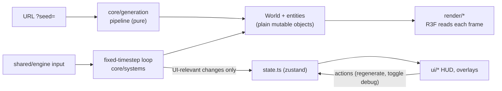

# Architecture

> Status: M0. Sections marked _(planned)_ describe the design the next milestones will
> implement; update them as the code lands.

## Layers

| Layer      | Folders                                                         | May import                            | Tech                |
| ---------- | --------------------------------------------------------------- | ------------------------------------- | ------------------- |
| App / site | `src/app`, `src/pages`                                          | all below (games only via `index.ts`) | React, react-router |
| UI         | `src/games/*/ui`, `src/shared/ui`                               | core, state                           | React DOM           |
| Render     | `src/games/*/render`, `src/games/*/assets`, `src/shared/render` | core, state                           | R3F, three, drei    |
| Core       | `src/games/*/core`, `src/shared/engine`                         | core only                             | Pure TypeScript     |

Dependency direction: **app → ui / render → core**. UI and render are siblings and don't import
each other; the game's root component (`IslandGame.tsx`) composes them. Shared code never
imports a game. All of this is enforced by `no-restricted-imports` blocks in
`eslint.config.js` and verified by `tests/layer-rules.test.ts`.

## Folder map

```
src/
  main.tsx                # Entry: mounts <App/>
  app/                    # App shell: App, router, Layout, global.css
  pages/                  # Route components: Home, GamesIndex, IslandGamePage, NotFound, RouteError
  shared/
    engine/               # Reusable pure TS (math; later RNG, loop, input, grid)
    render/               # (planned) reusable R3F pieces: pixel-perfect camera, sprite atlas
    ui/                   # (planned) shared UI components
  games/
    catalog.ts            # Plain metadata for every game (used by the games list)
    island/
      index.ts            # Public API: what pages may import
      IslandGame.tsx      # Composes render (canvas) + UI (HUD)
      state.ts            # zustand store, UI-facing state only
      core/config.ts      # All tunables
      core/world/         # (planned) world types, tile & object registries
      core/generation/    # (planned) pipeline steps + validate
      core/systems/       # (planned) movement, collision, animation
      render/             # GameCanvas (later Tilemap, Entities, Water, DebugOverlay)
      assets/             # (planned) procedural sprite atlas
      ui/                 # (planned) HUD, controls hint
tests/                    # Cross-cutting tests (architecture rules)
```

## Data flow _(planned)_



## Game loop _(planned)_

- R3F `useFrame` runs every rendered frame, but game logic advances in **fixed steps**
  (accumulator pattern), so movement is frame-rate independent.
- Logic mutates the world and entities directly; nothing per-frame goes through React state.
- Rendering reads the latest state. Only UI-relevant values (seed, debug flag, player tile for
  the overlay) are pushed into zustand, and only when they change.

## Generation pipeline _(planned)_

`shapeIsland → assignTerrain → carveLake → placeCabin → scatterTrees → scatterFlowers →
chooseSpawn → validate`

Each step is a pure function `(ctx) => ctx` over `{ map data, seeded RNG, config }`.
`validate` checks: borders are water, land share in range, exactly one lake not touching the
sea, cabin fully on land, spawn walkable and the cabin door reachable (BFS). On failure it
regenerates with a seed derived deterministically from the original, up to N attempts, then
shows a clear error.

## How-to guides

### Add a page

1. Create `src/pages/MyPage.tsx` exporting `MyPage(): JSX.Element`.
2. Add a route in `src/app/router.tsx` (use `lazy` if it pulls in heavy code).

### Add a new game

1. Create `src/games/<name>/` with `core/`, `render/`, `ui/`, `state.ts`, `index.ts` and a
   root component composing render + UI. Export only the root component from `index.ts`.
2. Add an entry to `GAME_CATALOG` in `src/games/catalog.ts`.
3. Add `src/pages/<Name>GamePage.tsx` and a lazy route `games/<name>` in the router.
4. Lint layer rules apply automatically through the `src/games/*/...` globs.

### Add a tile type _(planned, M1)_

Add an entry to the tile registry (id, name, walkable, layer, sprite key) and a sprite to the
atlas generator. No logic changes elsewhere.

### Add an object type _(planned, M1)_

Add an entry to the object registry (id, footprint, blocks movement, sprite key, depth anchor)
and a sprite; placement steps reference it by id.

### Add a system _(planned, M3)_

Create `core/systems/<name>.ts` with a pure `update(world, dt)` function, add a unit test, and
call it from the fixed-step update in order.

### Add or change a layer rule

Edit the relevant block in `eslint.config.js` (one block per folder glob; globs must not
overlap) and add cases to `tests/layer-rules.test.ts`.
