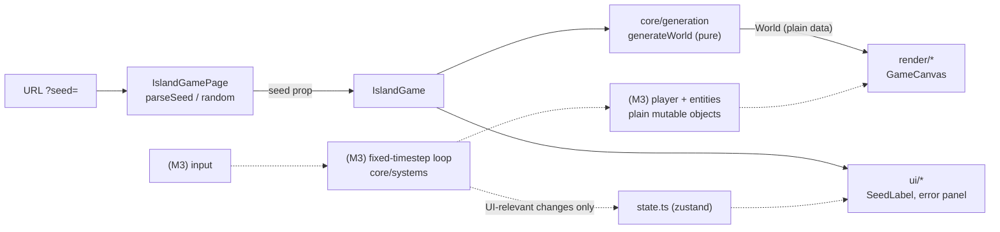

# Architecture

> Status: M1. Sections marked _(planned)_ describe the design the next milestones will
> implement; update them as the code lands.

## Layers

| Layer      | Folders                                                         | May import                            | Tech                |
| ---------- | --------------------------------------------------------------- | ------------------------------------- | ------------------- |
| App / site | `src/app`, `src/pages`                                          | all below (games only via `index.ts`) | React, react-router |
| UI         | `src/games/*/ui`, `src/shared/ui`                               | core, state                           | React DOM           |
| Render     | `src/games/*/render`, `src/games/*/assets`, `src/shared/render` | core, state                           | R3F, three, drei    |
| Core       | `src/games/*/core`, `src/shared/engine`                         | core only                             | Pure TypeScript     |

Dependency direction: **app → ui / render → core**. UI and render are siblings and don't import
each other; the game's root component (`IslandGame.tsx`) composes them. Shared code never
imports a game. All of this is enforced by `no-restricted-imports` blocks in
`eslint.config.js` and verified by `tests/layer-rules.test.ts`.

## Folder map

```
src/
  main.tsx                  # Entry: mounts <App/>
  app/                      # App shell: App, router (with HydrateFallback), Layout, global.css
  pages/                    # Route components; IslandGamePage reads ?seed=
  shared/
    engine/                 # Reusable pure TS: math, random (mulberry32, seeds), noise, grid
    render/                 # (planned) reusable R3F pieces: pixel-perfect camera, sprite atlas
    ui/                     # (planned) shared UI components
  games/
    catalog.ts              # Plain metadata for every game (used by the games list)
    island/
      index.ts              # Public API: IslandGame
      IslandGame.tsx        # Generates the world for a seed; composes render + UI
      state.ts              # zustand store, UI-facing state only (unused until M4)
      core/
        config.ts           # IslandConfig: every tunable number
        world/              # tiles.ts, objects.ts (registries), world.ts (World type), collision.ts
        generation/         # context, steps/*, validate, pipeline, generateWorld
        systems/            # (planned, M3) movement, collision response, animation
      render/               # GameCanvas, FitMapCamera, WorldColorMap (+ texture builder)
      assets/               # (planned, M2) procedural sprite atlas
      ui/                   # SeedLabel, GenerationErrorPanel, islandUi.css
tests/                      # Cross-cutting tests (architecture rules)
scripts/browser-check.mjs   # Dev-only headless Chrome check (screenshot + console)
```

## Data flow



## World data

- `World` is plain data: `terrain: Uint8Array` (TileId per tile), `objects: WorldObject[]`
  (kind + top-left tile), `occupancy: Int32Array` (object id per tile or `NO_OBJECT`),
  `blocked: Uint8Array` (collision mask), `cabin`, `spawn`, `seed`, `generationSeed`.
- Grids are row-major (`index = y * width + x`) with **y growing downwards**. Render code
  flips y when converting to Three.js coordinates (y up).
- Rules about tiles and objects come from the registries (`isWalkableTile`, `waterBody`,
  `blocksMovement`, `footprint`, `door`), never from comparing ids in logic.

## Generation pipeline

`shapeIsland → assignTerrain → carveLake → placeCabin → scatterTrees → scatterFlowers →
chooseSpawn → validate`

| Step             | What it does                                                                                                                                                                            |
| ---------------- | --------------------------------------------------------------------------------------------------------------------------------------------------------------------------------------- |
| `shapeIsland`    | Elevation = fractal noise blended with a radial gradient (`radialWeight`)                                                                                                               |
| `assignTerrain`  | Elevation thresholds → deep/shallow sea, sand, grass; forced deep-sea edge band; keep the largest landmass; fill water not connected to the edge                                        |
| `carveLake`      | Noise-bent blob placed where the coast distance leaves room for lake + shore + gap; 8-way shallows rim and sand shore                                                                   |
| `placeCabin`     | Random site where footprint + margin + front clearance are grass and away from water; reserves that area                                                                                |
| `scatterTrees`   | Forest noise above a threshold → dense trees; meadows → rare lone trees; species noise groups oaks/pines                                                                                |
| `scatterFlowers` | Patch noise → flower patches (colour from a colour noise), scattered flowers, grass tufts                                                                                               |
| `chooseSpawn`    | Tile in front of the cabin door if walkable                                                                                                                                             |
| `validate`       | Borders deep sea, land share in range, exactly one lake not touching the sea (8-way), cabin on land, door reachable from spawn (BFS) and at least `minReachableShare` of land reachable |

- Each step is a pure `(context) => context` function; it copies the arrays it changes.
- Each step draws from its own RNG stream, `createRng(deriveSeed(seed, stepName))`, so
  changing one step's randomness doesn't reshuffle the others.
- `generateWorld(seed, config)` runs the pipeline; on validation failure it retries with
  `deriveSeed(seed, 'retry-N')` up to `generation.maxAttempts`, then returns
  `{ ok: false, issues }`, which `IslandGame` shows in `GenerationErrorPanel`.

## Game loop _(planned, M3)_

- R3F `useFrame` runs every rendered frame, but game logic advances in **fixed steps**
  (accumulator pattern), so movement is frame-rate independent.
- Logic mutates the player/entities directly; nothing per-frame goes through React state.
- Rendering reads the latest state. Only UI-relevant values (seed, debug flag, player tile for
  the overlay) are pushed into zustand, and only when they change.

## Rendering

- **Now (M1 preview):** one plane with a `DataTexture` of one texel per tile (nearest
  filtering); drei `OrthographicCamera` zoomed to fit the map. 1 world unit = 1 source pixel.
- **(planned, M2):** sprite atlas by key, chunked tilemap, instanced decorations, y-sorted
  depth, animated water, pixel-perfect camera.
- Textures created by hand are disposed in an effect cleanup; JSX-declared geometries and
  materials are disposed by R3F.

## How-to guides

### Add a page

1. Create `src/pages/MyPage.tsx` exporting `MyPage(): JSX.Element`.
2. Add a route in `src/app/router.tsx` (use `lazy` if it pulls in heavy code).

### Add a new game

1. Create `src/games/<name>/` with `core/`, `render/`, `ui/`, `state.ts`, `index.ts` and a
   root component composing render + UI. Export only the root component from `index.ts`.
2. Add an entry to `GAME_CATALOG` in `src/games/catalog.ts`.
3. Add `src/pages/<Name>GamePage.tsx` and a lazy route `games/<name>` in the router.
4. Lint layer rules apply automatically through the `src/games/*/...` globs.
5. Reuse `shared/engine` (random, noise, grid) instead of copying it.

### Add a tile type

1. Add an id to `TileId` and a definition to `TILE_DEFINITIONS` (same index) in
   `core/world/tiles.ts`: key, name, `isWalkable`, `waterBody`, `spriteKey`, `mapColor`.
2. Produce it in a generation step (e.g. a threshold in `assignTerrain` or a new step).
3. (M2+) Add its sprite to the atlas under `spriteKey`. Collision and validation pick up
   `isWalkable`/`waterBody` automatically.

### Add an object type

1. Add the kind to `OBJECT_KINDS` and a definition to `OBJECT_REGISTRY` in
   `core/world/objects.ts`: category, footprint, `blocksMovement`, `spriteKey`, `mapColor`.
2. Place it from a step using `isAreaFree` / `addObject` (`generation/objectLayer.ts`). New
   flowers or trees are picked up through `FLOWER_KINDS` / `TREE_KINDS` automatically.
3. (M2+) Add its sprite under `spriteKey`.

### Add a generation step

1. Create `core/generation/steps/<name>.ts` exporting a `GenerationStep`; copy any arrays you
   change; get randomness from `createStepRng(context, '<name>')`.
2. Insert it in `GENERATION_STEPS` (`pipeline.ts`); add tunables to `IslandConfig`.
3. If it introduces an invariant, add a check to `validate.ts` and a test.

### Add a system _(planned, M3)_

Create `core/systems/<name>.ts` with a pure `update(state, dt)` function, add a unit test, and
call it from the fixed-step update in order.

### Add or change a layer rule

Edit the relevant block in `eslint.config.js` (one block per folder glob; globs must not
overlap) and add cases to `tests/layer-rules.test.ts`.
